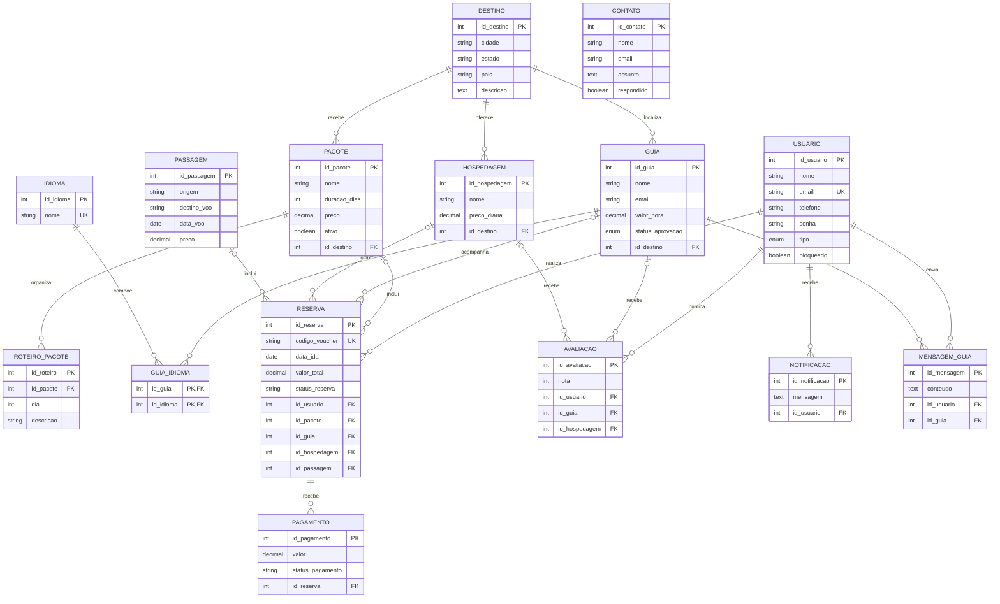

# Diagrama entidade-relacionamento

Uma avaliação deve apontar para um guia ou uma hospedagem (o outro relacionamento fica nulo).
Uma reserva de hospedagem avulsa pode ter `id_pacote` e `id_guia` nulos.
